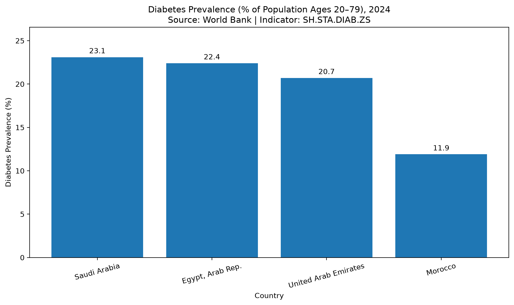

# Healthcare Data Engineering Project

An educational portfolio project developed as part of my Data Engineering training. It demonstrates how healthcare-related data can be collected, cleaned, validated, stored, and queried using Python, SQL, and SQLite.

The repository contains two data engineering workflows:

1. A sample healthcare database built around patient, doctor, insurance, disease, and appointment data.
2. A World Bank data pipeline that retrieves aggregated diabetes prevalence statistics for four countries, validates the data, loads it into SQLite, and generates a visualization.

> **Important:** This is an independent training and portfolio project. It is not connected to Gammal Tech's production systems and does not use real patient records or confidential healthcare data.

## Project Objectives

* Collect data from CSV files and a public data API.
* Clean and validate incoming datasets.
* Store structured data in relational SQLite databases.
* Use SQL to inspect records and check data quality.
* Automate data ingestion and database loading.
* Produce a simple visualization from validated data.

## 1. World Bank Diabetes Data Pipeline

The World Bank pipeline retrieves diabetes prevalence statistics through the World Bank Indicators API.

### Data Source

**Indicator:** Diabetes prevalence (% of population ages 20 to 79)

**Indicator code:** `SH.STA.DIAB.ZS`

**Countries:**

* Egypt (`EGY`)
* Saudi Arabia (`SAU`)
* United Arab Emirates (`ARE`)
* Morocco (`MAR`)

Official sources:

* [World Bank indicator page](https://data.worldbank.org/indicator/SH.STA.DIAB.ZS)
* [World Bank Indicators API](https://api.worldbank.org/v2/country/EGY%3BSAU%3BARE%3BMAR/indicator/SH.STA.DIAB.ZS?format=json&per_page=500)

The collected values are country-level statistics, not individual patient measurements or clinical diagnoses.

### Pipeline Architecture

```text
World Bank Indicators API
          |
          v
07_fetch_world_bank_diabetes.py
          |
          v
Cleaned and Validated CSV
world_bank_diabetes_countries.csv
          |
          v
08_load_world_bank_to_sqlite.py
          |
          v
SQLite Database
health_data.db
          |
          v
health_statistics Table
          |
          +----------------------+
          |                      |
          v                      v
SQL Queries                 Visualization
10_query_health_statistics  12_visualize_diabetes_2024.py
.sql                             |
                                 v
                     diabetes_prevalence_2024.png
```

The `11_run_health_pipeline.py` script orchestrates the data-fetching, database-loading, and visualization steps.

### Data Quality Checks

The World Bank pipeline includes checks for:

* Required columns and missing values.
* Numeric year and indicator values.
* Duplicate observations using `Country`, `Year`, and `Indicator_Code`.
* Indicator values outside the expected percentage range of 0–100.
* Successful loading of the dataset into SQLite.

Observations with missing indicator values are excluded from the exported CSV by the current fetching script.

### Database Table

The World Bank dataset is stored in the `health_statistics` table in `health_data.db`.

The table includes:

| Column           | Description                     |
| ---------------- | ------------------------------- |
| `Country`        | Country name                    |
| `Year`           | Observation year                |
| `Indicator_Code` | World Bank indicator identifier |
| `Indicator_Name` | Indicator description           |
| `Value`          | Reported indicator value        |
| `Source_URL`     | Data source URL                 |

### Current Dataset

The currently committed CSV contains eight non-missing observations across the four countries. The years represented in this extract are 2011 and 2024.

This is the result of the current API response, not a guarantee that these are the only years available from the World Bank. The available records can change when the pipeline is run again.

### Visualization

The project generates a bar chart comparing diabetes prevalence across the four countries for 2024.

The chart is saved as:

`diabetes_prevalence_2024.png`



The visualization is intended to demonstrate a basic data pipeline output. It does not establish the causes of differences between countries or provide individual medical advice.

## 2. Sample Healthcare Database

The original workflow demonstrates how sample patient data can be organized in a relational SQLite database.

### Database Tables

The sample database schema includes:

* `Insurance`
* `Patients`
* `Doctors`
* `Diseases`
* `Patient_Diseases`
* `Appointments`
* `Visit_Log`
* `Medical_Tests`
* `Family_Medical_History`

The schema uses relational database concepts such as primary keys, foreign keys, constraints, and indexes where defined in the SQL files.

### Data Cleaning Examples

The project includes examples of:

* Normalizing patient names.
* Normalizing phone numbers.
* Standardizing date formats.
* Standardizing marital status values.
* Cleaning doctor email addresses.
* Standardizing disease status values.
* Validating required patient fields.

### Duplicate Detection

The sample patient workflow includes duplicate-detection logic and SQL queries that inspect potential duplicate patients using:

```text
Name + Date of Birth + Phone Number
```

The sample workflow is intended for learning and should be tested against a clean database before claiming that repeated runs are fully idempotent or guarantee duplicate-free records.

## 3. SQL Queries and Data Quality Testing

The repository contains SQL files for inspecting database structure, retrieving records, joining related tables, and checking data quality.

The queries cover examples such as:

* Listing database tables.
* Retrieving patient, doctor, and appointment information.
* Joining patients with diseases and medical tests.
* Retrieving insurance and family medical history information.
* Counting records and grouping results.
* Inspecting missing or duplicate records.
* Checking World Bank observations by country and year.
* Validating indicator values and identifying duplicate observations.

Relevant files include:

* `03_queries.sql`
* `09_query_world_bank.sql`
* `10_query_health_statistics.sql`
* `test_queries.sql`

## 4. Technologies

* **Python** — pipeline development and orchestration.
* **Requests** — retrieving data from the World Bank API.
* **Pandas** — data preparation and validation.
* **SQLite** — relational data storage.
* **SQL** — data retrieval and quality checks.
* **Matplotlib** — visualization.
* **CSV** — data exchange.
* **Git and GitHub** — version control and project publishing.
* **Visual Studio Code** — development environment.

## 5. Project Structure

```text
Healthcare-Data-Engineering/
│
├── 01_create_tables.sql
├── 02_insert_data.sql
├── 03_queries.sql
├── 04_data_cleaning_examples.sql
├── 05_pipeline_load_public_like_data.py
├── 06_sample_public_like_patients.csv
│
├── 07_fetch_world_bank_diabetes.py
├── 08_load_world_bank_to_sqlite.py
├── 09_query_world_bank.sql
├── 10_query_health_statistics.sql
├── 11_run_health_pipeline.py
├── 12_visualize_diabetes_2024.py
│
├── world_bank_diabetes_countries.csv
├── diabetes_prevalence_2024.png
├── test_queries.sql
├── README.md
└── .gitignore
```

The SQLite database files are generated or maintained locally and excluded from Git through `.gitignore`.

## 6. How to Run the World Bank Pipeline

### Prerequisites

Install Python and the required packages.

From PowerShell in the project directory, run:

```powershell
py -m pip install requests pandas matplotlib
```

### Run the Complete Pipeline

From the project root directory, execute:

```powershell
py 11_run_health_pipeline.py
```

The script runs the following stages:

1. Fetch and validate World Bank data.
2. Save the dataset to `world_bank_diabetes_countries.csv`.
3. Load the validated dataset into `health_data.db`.
4. Generate the diabetes prevalence chart for 2024.
5. Save the chart as `diabetes_prevalence_2024.png`.

The chart window opens during the visualization stage. Close that window when you finish viewing the chart so the script can complete.

### Inspect the Results

* Open `world_bank_diabetes_countries.csv` to inspect the exported data.
* Use a SQLite extension in VS Code to open `health_data.db`.
* Execute the queries in `10_query_health_statistics.sql` to inspect the database and check data quality.
* Open `diabetes_prevalence_2024.png` to view the generated chart.

## 7. Key Data Engineering Concepts Demonstrated

* Data ingestion from a public API and CSV files.
* Data cleaning and standardization.
* Data validation and quality checks.
* Relational database design.
* SQL queries and joins.
* Duplicate detection.
* Loading structured data into SQLite.
* Pipeline orchestration.
* Data visualization.
* Git version control.

## 8. Scope and Limitations

This is a learning and portfolio project rather than a production healthcare data platform.

The World Bank pipeline currently focuses on one indicator and four countries. It demonstrates a working ingestion, validation, storage, querying, and visualization workflow.

The sample patient database is separate from the World Bank statistics database. No real patient records or confidential healthcare information are used.

Additional indicators, public healthcare datasets, broader automated quality reporting, and improved duplicate-handling behavior can be added as the project develops.

## Author

Mahmoud — Data Engineering Trainee
